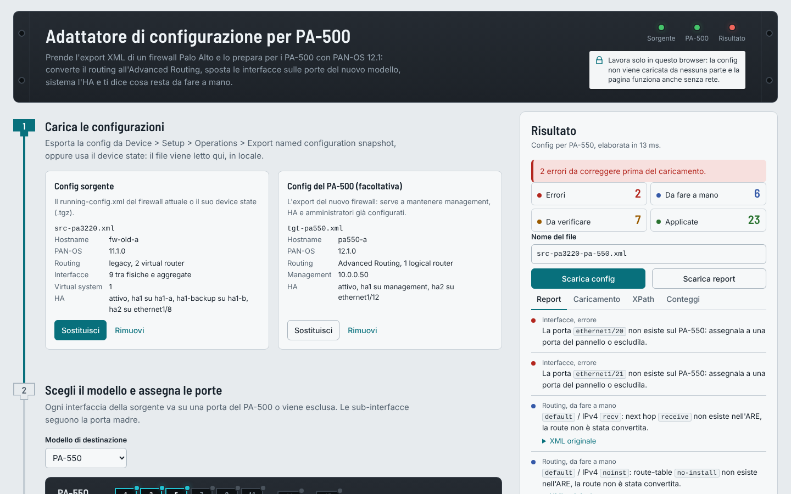

# Adattatore di configurazione PAN-OS per PA-500

Pagina web locale che prende l'export XML di un firewall Palo Alto e lo prepara per i PA-500 con PAN-OS 12.1. Converte il routing all'Advanced Routing Engine (obbligatorio su questi modelli), sposta le interfacce sulle porte del nuovo modello, sistema l'HA e produce un report di cosa resta da fare a mano.

È un unico file HTML senza dipendenze: si apre nel browser, funziona offline e la configurazione non viene mai caricata da nessuna parte.



## Perché

Sui PA-500 l'Advanced Routing non si può disattivare. Se importi la config o il device state di un firewall con il motore di routing legacy, il commit fallisce con `deviceconfig -> setting constraints failed : Disabling advanced routing is not allowed on this platform`. Lo script che converte i virtual router in logical router parte solo quando si attiva l'Advanced Routing, cosa che su questi modelli non succede mai. Questa pagina fa quella conversione sull'XML, prima del caricamento.

## Uso

1. Scarica [`dist/pa500-adattatore.html`](dist/pa500-adattatore.html) e aprila con Chrome, Edge o Firefox.
2. Carica il `running-config.xml` del firewall attuale, oppure direttamente il suo device state (`.tgz`). Se carichi anche l'export del PA-500, la pagina mantiene management, hostname, HA e amministratori del nuovo firewall.
3. Scegli il modello e assegna le porte: dalla tabella, oppure selezionando un'interfaccia e cliccando la porta sul pannello frontale.
4. Scegli le regole e scarica la config convertita e il report.
5. Importa il file sul PA-500, carica la config (completa o parziale: i comandi sono nella scheda «Caricamento») e lancia `validate full`.
6. Se validate restituisce errori, incollali al passo 4 della pagina: per ognuno trova l'elemento nella config convertita e propone una correzione, che diventa una regola XPath riutilizzabile.

Le regole personalizzate restano salvate nel browser e si possono esportare e importare in JSON.

## Cosa converte

| Area | Cosa fa |
|---|---|
| Advanced Routing | Virtual router → logical router con VRF `default`: interfacce, static route IPv4/IPv6, ECMP, admin distance, `next-vr` → `next-lr`. Imposta `deviceconfig/setting/advance-routing` e aggiorna l'import delle vsys. Sposta i profili BFD in `network/routing-profile/bfd`. |
| BGP | Impostazioni globali, peer group, peer, autenticazione, timer (in timer profile), aggregati semplici, redistribuzione semplice e prefissi annunciati. A ogni peer group IPv4 applica un address family profile con IPv4 unicast attivo. |
| OSPF | Aree normal, stub e NSSA, range, interfacce, link type, virtual link, autenticazione, timer (in interface timer profile), export rule semplici. |
| Porte | Rinomina in tutta la config, sub-interfacce comprese; scambio di porte; esclusione con rimozione dei riferimenti; segnala i riferimenti che restano. |
| HA | Porte HA dedicate (`ha1-a`, `hsci`, …) → porte dati in modalità HA o management. Sulla management toglie IP, maschera e gateway della sezione HA, che PAN-OS non accetta. Segnala link HA sulla stessa porta o nella stessa subnet e il `peer-ip` da aggiornare. Riconosce anche HA1 e HA2 sulle porte dedicate di default (sezione senza `<port>`). Il pulsante «Porte libere all'HA» propone porte dati libere, la più veloce per HA2. In alternativa usa l'HA già configurato sul PA-500. |
| Piattaforma | Porte inesistenti sul modello, velocità non supportate, aggregate su porte di tipo diverso, PoE, interfacce cellulari, multi-vsys, gestione da Panorama, versione della sorgente, residui del motore legacy. |

Policy BGP, route map e filtri complessi, OSPFv3, RIP e multicast non vengono convertiti: il report li riporta con l'XML originale, da ricreare a mano.

## Limiti noti

- Non è ancora stata provata su un PA-500 fisico: lancia sempre `validate full` prima del commit.
- La numerazione `ethernet1/N` delle porte è dedotta dalla posizione sul pannello frontale descritta nella PA-500 Hardware Reference. Verificala con `show interface all`.
- L'admin distance OSPF interna viene impostata a 30 come nel motore legacy (il default ARE è 110). Il report lo segnala.
- I limiti di capacità dei modelli (zone, regole, tunnel) non sono pubblicati in forma verificabile: la scheda «Conteggi» li fa inserire a mano.

## Chi ci lavora

Sul progetto lavorano il proprietario, Claude e ChatGPT. Le regole per rendere ogni commit, issue e pull request riconducibile a chi l'ha fatta sono in [AGENTS.md](AGENTS.md); la GitHub Action `Attribuzione e test` controlla il trailer `Agente:` di ogni commit e fa girare i test.

## Struttura

```
src/engine.js      motore di conversione, senza interfaccia
src/ui.js          interfaccia della pagina
src/style.css      stili
src/template.html  scheletro della pagina
build.py           assembla dist/pa500-adattatore.html
test/              test in Chromium headless e config di prova sintetiche
```

## Sviluppo

```sh
python3 build.py                      # rigenera dist/pa500-adattatore.html
pip install playwright pyyaml
python3 -m playwright install chromium
python3 test/test_engine.py           # conversioni e validazione contro lo schema ARE
python3 test/test_engine2.py          # regole personalizzate, errori di commit, casi limite
python3 test/test_ha.py               # link HA: porte condivise, management, backup, subnet
python3 test/test_ui.py               # percorso completo nella pagina, mobile e tema scuro
python3 test/perf.py                  # tempi su una config sintetica da circa 6 MB
```

`test/are_schema.json` contiene i percorsi XML ammessi sotto `network/logical-router` e `network/routing-profile`. È generato con `test/build_schema.py` dagli schemi di [pan-os-codegen](https://github.com/PaloAltoNetworks/pan-os-codegen) (licenza MIT, © Palo Alto Networks). I nomi `advance-routing` e `import/network/logical-router` vengono da [pan-os-python](https://github.com/PaloAltoNetworks/pan-os-python).

## Riferimenti

- [Enable Advanced Routing](https://docs.paloaltonetworks.com/ngfw/networking/advanced-routing/enable-advanced-routing)
- [PA-500 Series Firewall Overview](https://docs.paloaltonetworks.com/hardware/pa-500-hardware-reference/pa-500-series-firewall-overview)
- [Load a Partial Configuration](https://docs.paloaltonetworks.com/ngfw/pan-os-cli-quick-start/use-the-cli/load-a-partial-configuration)
- [Migration problem from PA220 to PA540 - Virtual Router](https://live.paloaltonetworks.com/t5/next-generation-firewall/migration-problem-from-pa220-to-pa540-virtual-router/td-p/1247661)
